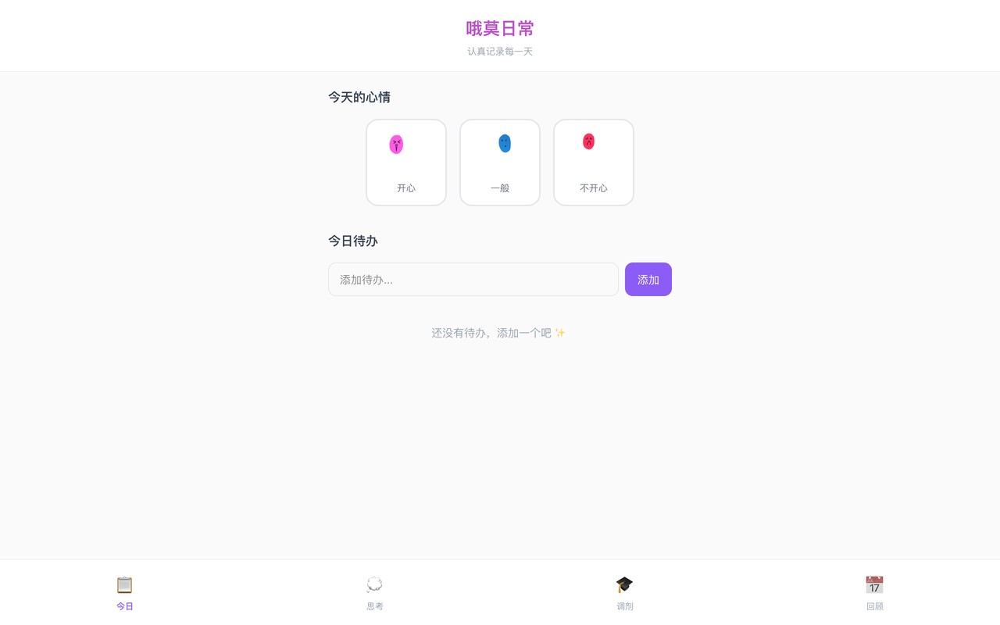

<div align="center">

# 哦莫日常 · omm-daily-happy

**更早之前学着做东西时留下的一个小脚印——装满心情、待办与自我探索的单文件日常原型。**

<p>
  <a href="https://nuts-and-bytes.github.io/omm-daily-happy/"><strong>翻看原型 ↗</strong></a> ·
  <a href="https://heystone.site/#experiments">回到 stone 工具箱</a> ·
  <a href="#english">English</a>
</p>

<br />



</div>

## 关于这份留档

这是我在 2026 年春天刚开始尝试做网页小工具时留下的早期原型快照。它把每天的心情打点、今日待办、自我探索问题收进了同一个单文件页面里——虽然青涩，也舍不得删，就作为成长路上的一个时间胶囊原样留档。

> 想体验后续更完整、持续迭代的日常记录作品，可以看看 [Daily Tree · 记忆森林](https://github.com/nuts-and-bytes/daily-tree) 或 [铁证 IRONPROOF](https://github.com/nuts-and-bytes/tiezheng)。

## 本地翻看

```bash
git clone https://github.com/nuts-and-bytes/omm-daily-happy.git
cd omm-daily-happy
python3 -m http.server 8000
```

浏览器打开 <http://localhost:8000/> 即可预览。

<details>
<summary><strong>快照边界说明</strong></summary>

<br />

- 仓库仅保留已内联样式与脚本的 `index.html` 构建产物，不提供原始组件源码与 `npm` 构建流程。
- 历史内嵌的 AI 接口凭据已移除，页面中的 AI 入口仅作静态保留，未接通在线服务。
- 心情与待办数据保存在当前浏览器 `LocalStorage`；页面中附带的早期静态信息模块仅为当时留存快照，非实时数据。
- 仓库目前未含独立 `LICENSE` 文件。

</details>

## English

An archived single-file web prototype from early 2026—a playful daily reflection space for mood check-ins, simple to-dos, and self-reflection prompts. Preserved as-is as an early milestone snapshot (no live AI backend configured; data stored locally in `LocalStorage`).

- [View snapshot ↗](https://nuts-and-bytes.github.io/omm-daily-happy/)

---

<p align="center">made by <a href="https://heystone.site/">stone</a> · 为 AI 世界留一点人味</p>
